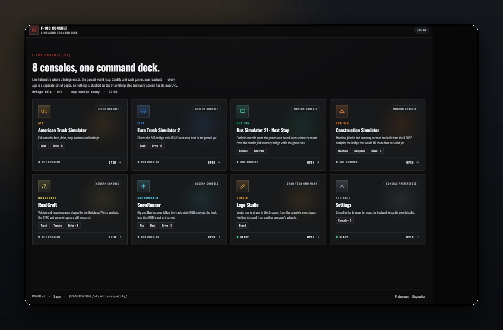
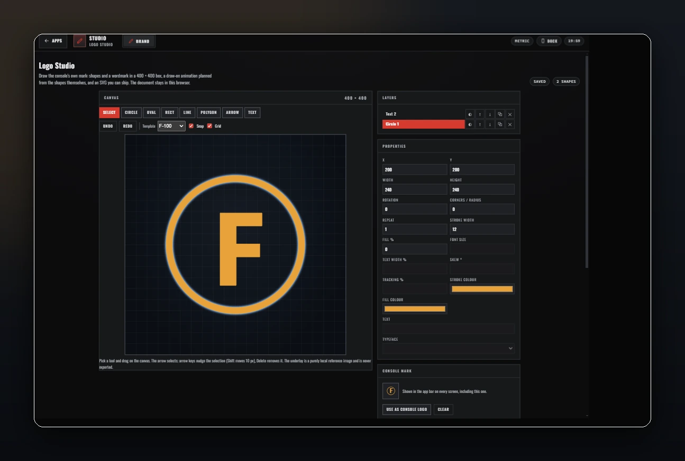
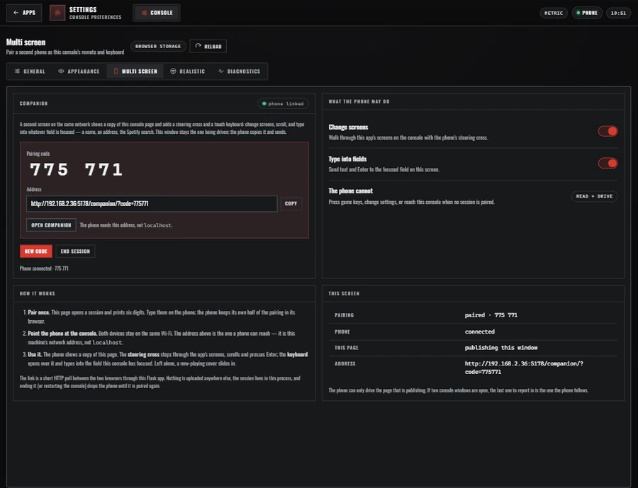
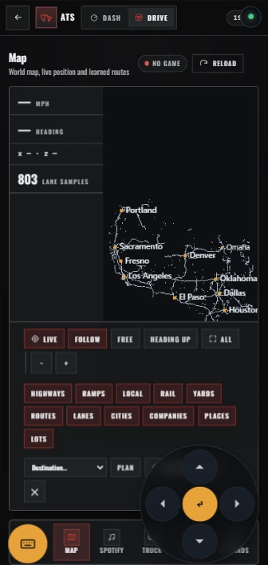
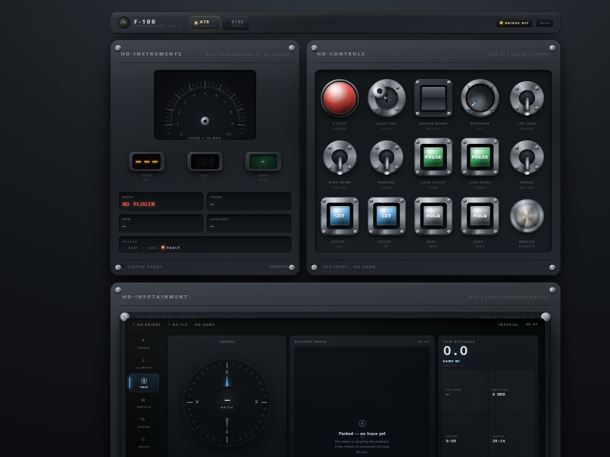

# F-100 Retro Truck Console

**A multi-simulator command deck for your driving rig.** F-100 brings truck dashboards, map navigation, route history, controls, Spotify, a mark designer, and a phone second screen together in one retro-inspired local console.

  

*The launcher: eight entries, live bridge status, and a URL for every screen. Captured locally with no simulator connected.*

## What it does

- **American Truck Simulator:** dashboard, interactive map built from the player's own game files, live telemetry, drive controls, assists, and binding layouts.
- **Euro Truck Simulator 2:** dashboard and the shared SCS integration; European map data is not parsed yet.
- **Bus Simulator 21:** service and cockpit screens backed by the optional `bussim_link` bridge.
- **Construction Simulator:** machine and company screens; telemetry integration is not available yet.
- **RoadCraft and SnowRunner:** dedicated truck/terrain and rig/haul screens, with game-specific telemetry integration still in development.
- **Drive head unit:** map, Spotify, truck controls, assists, and keybind layouts in one deep-linkable shell. Switching screens does not reload the page, so the map camera survives a trip to Spotify and back.
- **Logo Studio:** draw the console's own mark on a vector canvas, layer and edit shapes, plan a draw-on animation, export a script-free animated SVG, and wear it as the app-bar badge. Your drawing, not anyone else's logo.
- **Multi screen:** pair a phone on the same Wi-Fi as a second screen. It shows a copy of the console page, adds a steering cross and a popup touch keyboard, and slides a now-playing cover over the copy when left alone.
- **Settings:** appearance and house design names, units, map layers, Multi screen, realistic transmission readouts, and diagnostics.

The console shows when a game, bridge, or data bundle is unavailable rather than inventing telemetry or implying a control worked.

## What's new

- **Logo Studio** joins the launcher as a full app: shape tools, layers, numeric properties, templates, draw-on animation, SVG export, and a saved document that stays in the browser.
- **Multi screen** replaces the old app-and-screen chooser with a live mirror of the console. The phone's cross walks the current app's whole screen list, the keyboard types into whichever console field is focused, and the now-playing cover appears after half a minute of inactivity.
- **Assists** is now its own Drive screen: speed limit, lane keeping, indicators, and high beam, usable from the map and from the screen.
- **Realistic** joins Settings: transmission, engine, retarder, and axle readings exactly as the game reports them, with "No signal" instead of guesses.
- Every app now has a **browser-local preference store**, two design finishes, and per-app accents injected from one token vocabulary.

## Screenshots

### Logo Studio

  

Draw with the console's own geometry, order the stroke animation by contour length, and export an SVG that draws itself without JavaScript.

### Multi screen

  

Pair once from Settings. The six-digit code, the address a phone can reach, and the two permissions — change screens and type into fields — are all in one panel.

  

The phone renders the console's real URL at phone size, so it is the same screens and data rather than a second implementation. The steering cross walks the whole screen list, scrolls the page, and presses Enter; the keyboard opens over the copy and sends keystrokes to the console. Idle for thirty seconds while a track is playing and a now-playing cover slides up instead.

## Sneak peek — v3 hardware deck

One deck: the HD·Instruments cluster, an HD·Controls rack of physical switches
bound to the real SCS input actions, and the MFD-9. The Trip screen needs **no
map data**: the compass and heading tape read the game's heading, the trace
plots the positions the game publishes, and the meter integrates them (×19
world scale — the game odometer's convention), with teleports starting a new
segment instead of inventing road. Everything unpublished stays an em dash.

## Current status

F-100 is a local companion display, not a game modification or an online-game cheat. It runs as a Flask web app and reads simulator data through local integrations. A screenshot confirms the interface renders; it does **not** mean a simulator is connected or that game controls have been verified live.

- ATS map data is generated locally from the player's own game installation. Generated map files and proprietary game assets are not distributed with this project.
- ETS2 Europe map parsing is not implemented yet; the tile and map view say so.
- Bus Simulator 21 controls send the game's configured keys. Their in-game effect needs a live session to verify.
- Construction Simulator has no telemetry bridge yet. RoadCraft and SnowRunner integrations are still being developed.
- Spotify desktop mirroring and controller enumeration are Windows-first. Spotify Web API features require the user's own configuration.
- Multi screen pairs a phone with the console over the local network. The server must be bound to a reachable interface (`CONSOLE_HOST=0.0.0.0`); the pairing lives in the running process, so restarting the console unpairs the phone. Nothing is sent to a third party.

## Third-Party Trademark Disclaimers

This project is not affiliated with, endorsed by, or sponsored by any of the following trademark holders:

- **American Truck Simulator** and **Euro Truck Simulator 2** are trademarks of SCS Software. This project is not endorsed by or affiliated with SCS Software.
- **Bus Simulator 21** is a trademark of Oovee Limited. This project is not endorsed by or affiliated with Oovee Limited.
- **Construction Simulator** is a trademark of astragon Entertainment GmbH. This project is not endorsed by or affiliated with astragon Entertainment GmbH.
- **RoadCraft** and **SnowRunner** are trademarks of respective rights holders. This project is not endorsed by or affiliated with the owners of these trademarks.
- **Spotify** and the Spotify logo are trademarks of Spotify AB. This project is not endorsed by or affiliated with Spotify.

The F-100 Retro Truck Console is a local companion display that reads simulator data through local integrations. It does not modify games, bypass anti-cheat, or provide online cheats.

All design, start-up and finish names in the console are this project's own house labels (F-100 Slate, F-100 Amber, and so on). No manufacturer's logo, wordmark, palette or layout is reproduced, and the Logo Studio draws from its own shape library. Any name in Settings → Appearance can be renamed locally, and the start-up marks are generic geometry rather than anyone's badge.

Generated map data and SCS `.scs` files in this repository are created from the player's own game installations and are not distributed binary assets. No proprietary game assets or extracted copyrighted material is included in this repository.

## Source and setup

This GitHub repository now includes the **first source drop** — the v3 hardware deck under [`sneak-peek/`](sneak-peek/), which runs with Python 3 + Flask (`sneak-peek/src/run.py`, default port 5176) — while the full multi-simulator console source is still not included, so cloning this repository alone will not yet run the full console. The working application uses Python 3.14 and Flask and is served locally at `http://127.0.0.1:5178/`.

## Project links

- [F-100-Display on GitHub](https://github.com/thorcrafter/F-100-Display)
- [Launcher screenshot](screenshots/f100-command-deck.webp)
- [Logo Studio screenshot](screenshots/logo-studio.webp)
- [Multi screen screenshot](screenshots/multi-screen.webp)
- [Phone companion screenshot](screenshots/companion-map.webp)
