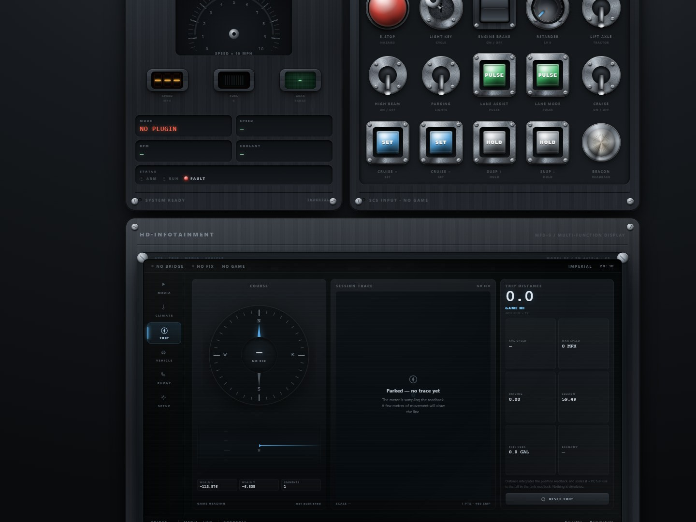
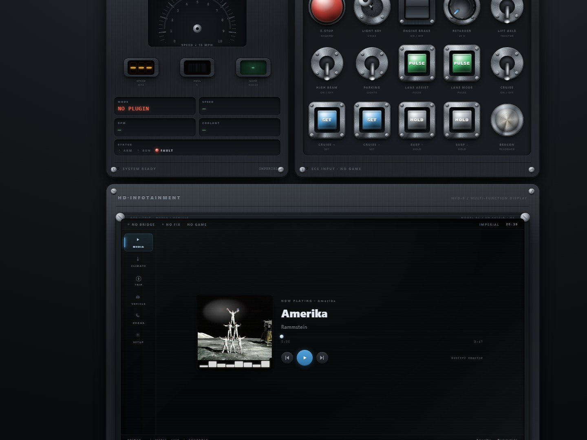
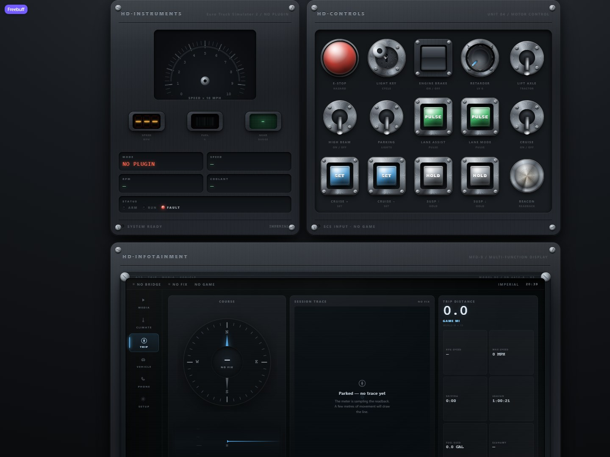

# F-100 Display — v3 sneak peek: the hardware deck

This is the first source drop for the project: the console rebuilt on the
*HD·Controls* design engine as **one piece of truck hardware** instead of a web
app — no launcher, no app bar, just a deck:

| Bay | What it is |
|---|---|
| HD·Instruments | speed dial, seven-segment speed, fuel bar, gear LCD, status lamps — read-only telemetry |
| HD·Controls | 15 physical switches (E-STOP mushroom, light key, engine brake, retarder wheel, lift axle, lights, lane assist, cruise, suspension hold buttons, beacon lamp) — the only write surface |
| HD·Infotainment MFD-9 | six screens: Media · Climate · Trip · Vehicle · Phone · Setup |

## Screenshots

### The whole deck (Trip on the MFD)


### Trip MFD — a trip computer with no map



This build **reads no map data** — no baked bundle, no road graph, no
`/mapfiles` route. The Trip screen works from what the game itself publishes
over the SCS telemetry plugin:

- the compass and heading tape read the heading readback;
- the session trace plots the `x`/`y` positions the game publishes;
- the meter integrates those points into a distance (world metres × 19 — the
  map's scale, which is what the in-game odometer shows), plus moving time,
  average and top speed, and fuel burnt as the fall in the tank readback;
- a jump too large for the reported speed (garage, ferry, reload) starts a new
  segment instead of inventing road — and a parked truck shows *Parked* rather
  than pretending to record.

Everything unpublished stays an em dash. Nothing is simulated to fill a panel.

### Media MFD — the OS media session



Media mirrors the desktop's OS media session (Spotify, etc.). The transport
buttons send real media keys to that player.

### HD·Controls rack



The rack is not a mock-up of the engine's components — it *is* the HD·Controls
engine v1.4 (`engine.css` + `hd-engine.js`) with every switch bound to one SCS
input action. Readbacks drive the switches silently so the panel agrees with
the truck.

## What's wired and what isn't

| Screen | State |
|---|---|
| Media | live — OS media session + transport |
| Climate | honest empty state — the SCS SDK publishes no cabin climate |
| Trip | live — dead-reckoned from the position readback (no map file) |
| Vehicle | live — SCS plugin fields only |
| Phone | honest empty state — no handset link in this build |
| Setup | live — units, bridge health, position fix, trip summary |

## Running it

`src/` is the deck. It needs Python 3 + Flask only:

```bash
cd src
cp .env.example .env            # host + port
python -m venv .venv
.venv/Scripts/pip install -r requirements.txt   # Windows
#.venv/bin/pip install -r requirements.txt      # Linux/macOS
python run.py                   # http://127.0.0.1:5176
```

Two integration points are loaded **in place, never copied** — this sneak peek
expects to sit next to the parent development checkout:

- **SCS telemetry bridge** (`../../v2/backend/services/truck_controls.py` +
  `scs_sdk.py`) — the 288-byte shared-memory reader and its 24 input actions.
  With the game closed the deck reports *no plugin* cleanly, exactly as the
  screenshots above show;
- **OS media mirror** (`../../v2/backend/services/spotify_bridge.py`) — the
  GSMTC media-session mirror. Without it the Media screen shows an empty
  state, not fake tracks.

Without those neighbours the deck still boots and renders — the bridges are
optional at run time, and Setup reports what is missing.

## Layout of this folder

```
sneak-peek/
├── screenshots/          the photos above
├── src/
│   ├── backend/          Flask app: registry, pages, telemetry/controls/media/trip APIs
│   ├── frontend/         stylesheet (engine + deck), JS (engine, deck, trip), favicon
│   ├── tests/            route, trip-math and no-map-data tests (unittest)
│   ├── run.py            entry point · port 5176
│   └── requirements.txt
```

`src/tests` run with plain `unittest`:

```bash
python -m unittest discover -s sneak-peek/src/tests -v
```

## Trademarks and scope

F-100 Display is a local companion display. It reads simulator data through
local integrations and does not modify games, bypass anti-cheat or act on other
players. American Truck Simulator and Euro Truck Simulator 2 are trademarks of
SCS Software; this project is not affiliated with or endorsed by SCS Software.
